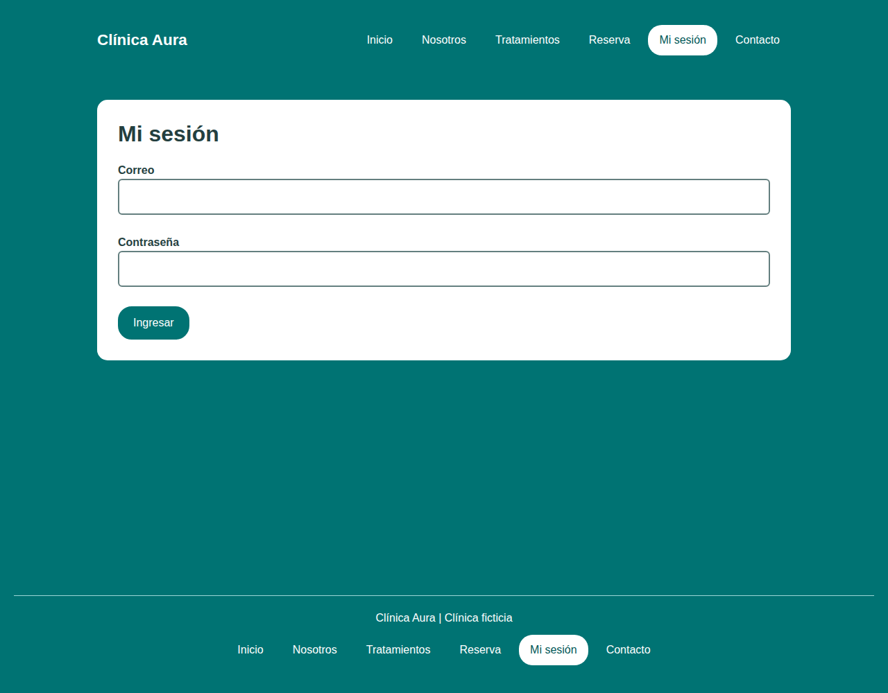
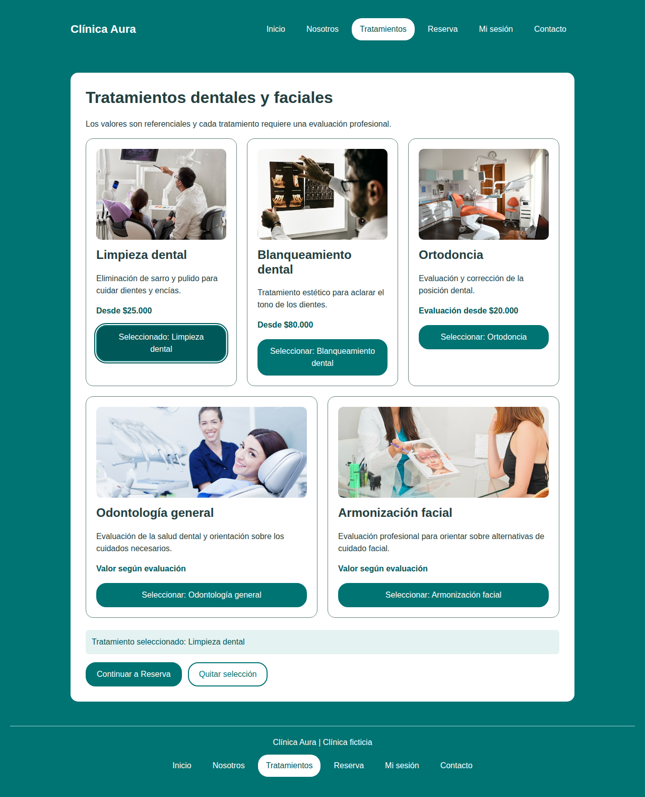
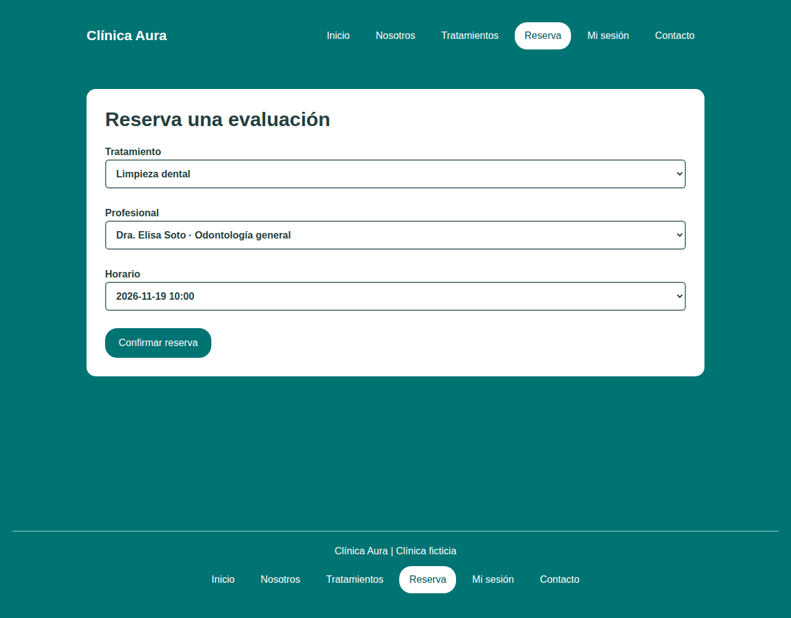
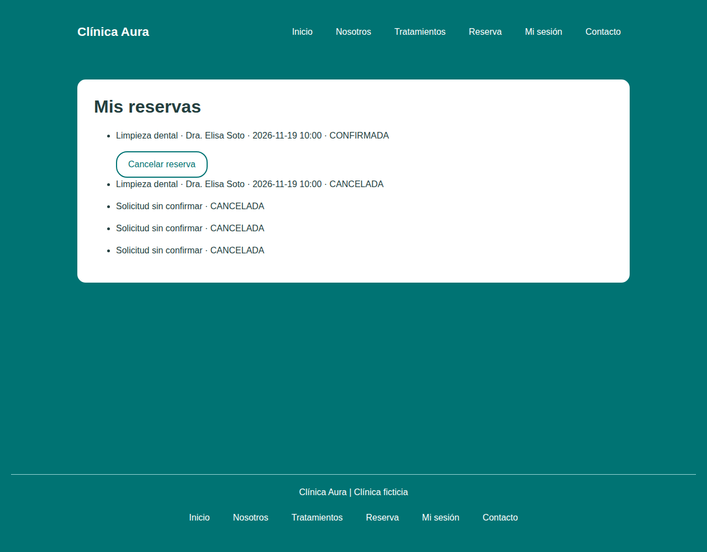
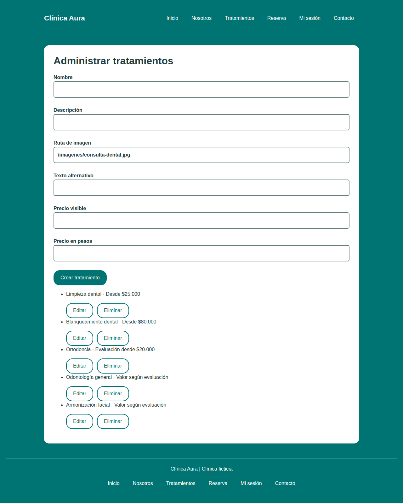
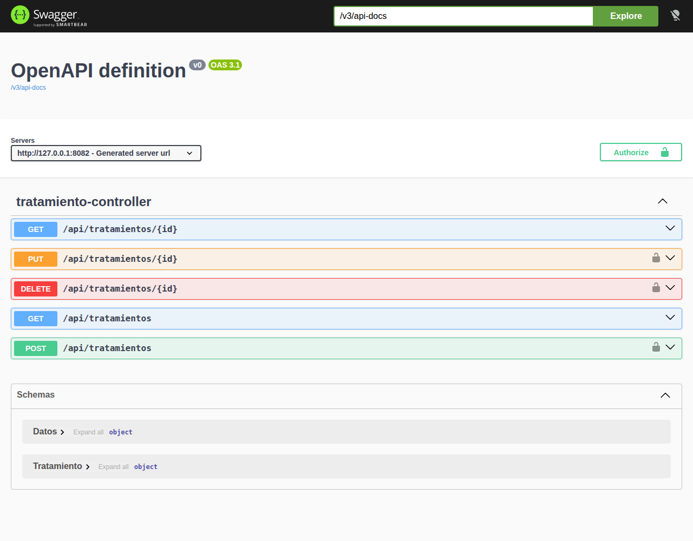

# Manual de usuario de Clínica Aura

Abre [Clínica Aura](http://localhost:3000) después de seguir la [guía de arranque](../../backend/README.md).

## Ingresar

Pulsa **Mi sesión** e introduce el correo y la contraseña de una cuenta de demostración. Usa `paciente@clinica.test` para reservar y `admin@clinica.test` para administrar tratamientos. Al recargar la página, la aplicación recupera tu sesión si todavía está vigente.

## Elegir un tratamiento

Abre **Tratamientos** y pulsa **Seleccionar** en la tarjeta elegida. Luego pulsa **Continuar a Reserva**. El formulario conserva el tratamiento seleccionado.

## Reservar y cancelar

En **Reserva**, elige un profesional y un horario disponible. Como paciente puedes pulsar **Confirmar reserva**. Si otra persona acaba de ocupar el mismo horario, elige otro bloque.

Desde **Mi sesión → Mis reservas** consulta la fecha y el estado de tus solicitudes. Pulsa **Cancelar reserva** y confirma para liberar el horario.

## Mantener el catálogo

Como administrador, abre **Mi sesión → Administrar tratamientos**. Escribe el nombre, descripción, ruta de imagen, texto alternativo y precio visible. Pulsa **Crear tratamiento**. Para cambiar un registro, pulsa **Editar** y guarda los cambios. Para quitar uno, pulsa **Eliminar** y confirma.

## Abrir Swagger

Abre [Swagger de Tratamientos](http://127.0.0.1:8082/swagger-ui.html). Expande `GET /api/tratamientos`, pulsa **Try it out** y después **Execute**. Los endpoints de escritura requieren el JWT de administrador. La [guía del backend](../../backend/README.md) enlaza las cinco APIs.

